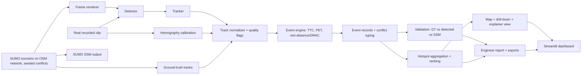

# PS-02 Vision Zero — Updated Project Plan (v2)

> **What changed from v1:** SUMO is now the primary pipeline and runs through a *real detector*; validation against seeded scenarios and SUMO's own safety metrics is a core deliverable; conflict patterns, an indicator explainer, hotspot drill-down and an engineer-facing report with review areas are core (not stretch); privacy now covers license plates; no-fault rules are enforced in code; timeline, owners, demo script and cut-line are added; a web app section (Streamlit, pre-computed results, page structure, deployment) is added; the edge-case table is split into "must implement" and "document only".

---

## 1. Problem statement summary

**PS-02: Vision Zero — Road risk and near-miss intelligence** (Track T2: Smart Cities & Public Safety).

**Goal:** Identify dangerous road locations from near-misses and traffic-conflict patterns *before* crashes occur. Analyse recorded or simulated traffic and turn risk indicators into useful information for road engineers.

**Scope:** Recorded or simulated traffic. At least one near-miss indicator.

**Expected deliverables**

1. Recorded or simulated traffic-data input.
2. Vehicle and pedestrian detection.
3. Calculation and explanation of at least one near-miss indicator.
4. A map of road-risk hotspots.
5. A report or summary for road engineers.

**Data to use:** Prepare synthetic traffic scenes and tracks with vehicle/pedestrian labels, timestamps and positions.

**Review focus (what judges will look for):** Demonstrate detection, explain the near-miss indicator, and show how mapped hotspots support engineering review.

**Key constraint:** No face identification and no assignment of fault.

**Four teams share this PS**, so differentiation matters (see Section 10).

### How this plan maps to the review focus

| Review focus | Where it is delivered |
|---|---|
| Demonstrate detection | Detector + tracker run on **rendered SUMO frames** *and* one real clip; detection metrics reported (Sections 4, 8) |
| Explain the near-miss indicator | Dedicated **indicator explainer view** (Section 5.3) |
| Show how mapped hotspots support engineering review | Hotspot → events → evidence → indicator drill-down, ranked list, review areas, GIS export (Section 5.4–5.5) |

---

## 2. Product target

Build a small, reproducible demonstration that:

1. Generates seeded traffic scenarios in SUMO on a real-map road network.
2. Renders the scenes to frames, **detects and tracks** vehicles/pedestrians, and also does so on one real recorded clip.
3. Calculates transparent conflict indicators (TTC, PET, plus a simple supporting measure) from the tracks.
4. **Validates** the detected-track results against SUMO ground truth and SUMO's built-in safety metrics.
5. Aggregates conflicts into ranked, exposure-aware hotspots on a map.
6. Produces an engineer-facing report with evidence, conflict patterns and neutral "areas to review".

### Minimum viable demo (must ship)

- One SUMO scenario on an OSM-based intersection with seeded conflicts (vehicle–pedestrian crossing, turning vs. oncoming, bike cutting across).
- Frame rendering → detector → tracker → track table in the shared schema.
- TTC for candidate pairs, and PET for defined conflict zones.
- Comparison of detected-track events vs. ground-truth events (recall, spurious events).
- Hotspot map with count, rate, min TTC/PET, conflict type, road-user pair, quality flags and coverage.
- Indicator explainer view for one event.
- Report (HTML/PDF) plus CSV/GeoJSON exports.
- One short real recorded clip showing detection (and tracking) on real footage.

### Stretch goals

- **What-if scenarios in SUMO:** change one thing (signal timing, add a crossing refuge, lower approach speed), re-run, and show the change in conflicts and hotspot ranking.
- Optional second detector/tracker baseline with a measured comparison.
- Full video-derived conflict analysis (calibrated homography) on the real clip.
- Comparison by time of day on longer simulated runs with varying demand.

---

## 3. Resources and stack

| Need | Choice | Purpose / notes |
|---|---|---|
| Synthetic data | **SUMO** (vehicles, pedestrians, bicycles) | Repeatable, seedable intersection/crossing/turning scenarios. [SUMO docs](https://sumo.dlr.de/docs/index.html) |
| Real-map network | **netconvert / osmWebWizard** from OpenStreetMap | Network stores a geo-projection so `sumolib` converts x,y ↔ lat/lon; hotspots land on a real map |
| Ground-truth safety metrics | **SUMO SSM device** (TTC, DRAC, PET output) | Free, credible reference to cross-check our own TTC/PET |
| Scene rendering | SUMO-GUI screenshots **or** a custom oblique renderer (OpenCV/Pygame) | Produces frames for the detector. Test the camera angle early (see risk R1) |
| Video input & geometry | **Python + OpenCV** | Frames/timestamps, overlays, homography for the real clip |
| Detection | **Ultralytics YOLO (small variant, e.g. YOLO26n)** baseline | Validate class coverage on *both* synthetic frames and the real clip; fine-tune only if validation shows a clear gap |
| Tracking | **ByteTrack** first; **BoT-SORT** if camera motion/ID switches require it | [Tracking docs](https://docs.ultralytics.com/modes/track) |
| Calculations | **NumPy, pandas, SciPy, Shapely** | Smoothing, velocity, footprint geometry, aggregation |
| Hotspots | **GeoPandas** + road-segment bins (clustering optional) | Segment bins first; DBSCAN only in a consistent metric projection |
| Map & dashboard | **Streamlit + Folium/Leaflet** (multipage, pre-computed results; see Section 7) | Filters, map, drill-down, explainer view, report download. [Streamlit setup](https://docs.streamlit.io/get-started/installation) |
| Annotation | CVAT or a manual review spreadsheet | Label a **small hand-checked sample** for detection metrics (required, not optional). No faces/identity labels |
| Compute | Existing laptop; optional CUDA GPU | GPU helps detection throughput only |

**License check:** Ultralytics is AGPL-3.0 with Enterprise options. Confirm hackathon/submission rules before distributing code or weights. [Ultralytics licensing notes](https://docs.ultralytics.com/)

---

## 4. Pipelines

### 4.1 Primary pipeline: SUMO → frames → detection → tracks

```
SUMO scenario (seeded) ─┬─► ground-truth tracks (GT)
                        └─► rendered frames ─► detector ─► tracker ─► detected tracks (DT)
                                                                   │
                         GT and DT both normalized to the same schema
                                                                   ▼
                                            event engine (TTC / PET / min-distance)
```

- Run the event engine on **both** GT and DT. GT isolates the near-miss logic; DT shows the whole system working end to end. The gap between them is the system's measured accuracy.
- **Risk R1:** COCO-pretrained YOLO can perform poorly on pure top-down or flat synthetic renders. Test in the first hours. Mitigations in order: oblique camera angle → richer rendering (textured sprites) → fine-tune on a small set of auto-labelled SUMO frames (labels come free from ground truth).
- Auto-label rendered frames from GT positions to produce both training data (if needed) and the detection-metric evaluation set.

### 4.2 Secondary pipeline: real recorded clip

- One short fixed-camera clip (public/permitted source; avoid storing raw footage in the repo).
- Detector + tracker; ground-plane **homography** from visible landmarks with recorded calibration source and approximate error.
- If calibration is missing or poor: show **image-zone** conflicts only and mark metric values (distance, speed, TTC) as unavailable. Never report physical metrics from raw pixels.
- Purpose: prove detection works on real footage; metric conflicts on the clip are a bonus, not a requirement.

### 4.3 Detection and tracking rules

- Target classes: `person`, `bicycle`, `motorcycle`, `car`, `bus`, `truck` (where supported).
- **Defined class mapping** with a broad fallback (`vehicle` / `two-wheeler` / `pedestrian` / `other road user`). Near-miss logic must not depend on a fragile subtype. If the target roads include auto-rickshaws, e-rickshaws, handcarts or heavy two-wheeler traffic, map them explicitly into the fallback classes and note the detector's weakness there.
- Road contact point = bottom-centre of the box; flag clipped/occluded boxes.
- Avoid appearance re-identification (identity is not part of the problem).

### 4.4 Coordinates

- SUMO: use network coordinates; convert to lat/lon via the network's projection (`sumolib`).
- Video: image → road plane via homography; record calibration source and error.
- One shared metric projection for all geometry and clustering.

---

## 5. Methods and product features

### 5.1 Near-miss indicators

1. **TTC (primary):** constant-velocity prediction over a short horizon using **buffered footprints** (SUMO gives vehicle length/width; use a radius for pedestrians) rather than point distance. Reject non-closing pairs. Sample at **0.1–0.2 s** so short TTCs are resolvable.
2. **PET (for crossings):** elapsed time between the first road user leaving a defined conflict zone and the second entering it. Only when the zone/path geometry is valid.
3. **Supporting measure:** minimum distance and/or **DRAC** (deceleration needed to avoid collision). Showing indicator agreement/disagreement supports the "no single opaque score" goal.
4. **Thresholds:** configurable, visible, **sourced from surrogate-safety literature** (cite in the report; e.g., commonly used TTC/PET severity bands), plus a **sensitivity check** — show how hotspot rankings change when thresholds move ±20–30%.
5. **Cross-check:** compare our TTC/PET against SUMO's SSM output on the same scenarios; report agreement.

### 5.2 Conflict typing and patterns (core)

- Label each event with a **conflict type**: vehicle–pedestrian crossing, turning vs. through, same-direction closing, bicycle/two-wheeler interaction, other.
- Event table supports breakdowns by **time window, movement type, road-user pair, approach**. These are the "traffic-conflict patterns" the PS asks for.

### 5.3 Indicator explainer view (deliverable-level)

For any selected event show:
- The two tracks over time with velocity vectors and closing speed.
- The TTC (or PET) calculation step by step with the formula and the inputs.
- The threshold used and the resulting severity band.
- Quality flags (track length, calibration, detection confidence) and GT/SSM comparison where available.
- Neutral labels (see 5.6).

### 5.4 Hotspots and drill-down

- Aggregate by road segment, intersection approach, or calibrated zone.
- Show **raw count and exposure-normalized rate** (per 1,000 road users or per observation hour), with observed road users, usable minutes and calibration coverage.
- **Uncertainty-aware ranking:** minimum-exposure rule and/or confidence intervals so one event cannot create a "top hotspot".
- **Drill-down flow:** click hotspot → event list → evidence overlay/clip → indicator explainer.
- Ambiguous boundary events: documented snapping rule or flagged as ambiguous.

### 5.5 Engineer report and exports

The report must contain:
- Data source, coverage, observation duration, road-user counts, method, thresholds (with sources) and limitations.
- **Ranked hotspot list** with evidence: count, rate, min TTC/PET, conflict type, road-user pair, time window, quality flags.
- **Conflict-pattern summary** (by time, movement type, road-user pair).
- **Validation summary:** detection precision/recall on the labelled sample; event recall/spurious rate on seeded scenarios; agreement with SUMO SSM.
- **Candidate review areas**, phrased neutrally as areas to investigate — e.g., "crossing visibility, signal phasing, refuge island, approach speed management" — never as causes or findings of fault.
- Distinction between "none observed" and "safe".

Exports: **PDF/HTML report, CSV event table, GeoJSON hotspots** (openable in GIS).

### 5.6 Privacy and no-fault rules (enforced, not just guidelines)

**Privacy**
- No face identification, embeddings or face crops. No license-plate reading or storage; blur plates and faces in any evidence frames.
- Keep raw video out of the repo and the report; store event metadata plus non-identifying overlays.
- Synthetic frames carry no personal data, which is another reason SUMO is primary.

**No-fault**
- Neutral road-user labels (e.g., "Road user 1 / Road user 2" ordered by ID, never by role) — no ordering that implies culprit and victim.
- No role-implying scenario names ("red-light runner", "jaywalker") in the UI or report.
- Neutral vocabulary: "candidate conflict", "approach", "observed trajectory".
- **Automated check:** scan generated report/UI text for blame words (fault, cause, violation, reckless, jaywalking, illegal, at fault, etc.) and fail the build if found.

---

## 6. Architecture



### Data contracts

**Track row:** `source_id`, `source_type` (`sumo_gt` | `sumo_detected` | `video`), `timestamp_s`, `track_id`, `class`, `class_group`, `x`, `y`, `coordinate_system`, `confidence`, `quality_flags`.

**Event row:** `event_id`, `timestamp_s`, `road_user_1`, `road_user_2` (neutral ordering by ID), `conflict_type`, `indicator_type`, `indicator_value`, `secondary_indicator_value`, `location_x`, `location_y`, `lat`, `lon`, `segment_id`, `severity_band`, `source_type`, `quality_flags`, `evidence_ref`, `ssm_reference_value` (if available).

**Hotspot row:** `segment_id`, `geometry`, `event_count`, `observed_road_users`, `observation_minutes`, `rate`, `rate_ci_low`, `rate_ci_high`, `min_ttc`, `min_pet`, `dominant_conflict_type`, `coverage_flags`.

---

## 7. Web app (new)

### 7.1 Framework decision

| Option | Decision | Reason |
|---|---|---|
| **Streamlit** | **Primary dashboard** | Fastest to build; native fit with pandas/GeoPandas/Folium; built-in filters, tables and download buttons; simple free hosting (Streamlit Community Cloud) |
| **Gradio** | Optional small tab only | Good for an "upload an image/clip → see detections" demo; weak for multi-page dashboards and map drill-down. Use only if a live-upload detection demo is wanted |
| **Django** | Not used | Adds auth, database and API overhead the PS does not require. Reconsider only if the submission rules demand a backend or multi-user features |

### 7.2 Design principle: pre-compute, then display

- The pipeline (SUMO, rendering, detection, tracking, events, hotspots) runs **offline** and writes result files. The web app only **reads** them. Live detection on a hosted free tier is slow and fragile, and a live failure would sink the demo.
- Result files (small, versioned per scenario run): `tracks.parquet`, `events.parquet`, `hotspots.geojson`, `validation.json`, `config.json` (thresholds and sources), annotated evidence frames/clips, and the generated report (HTML/PDF).
- Each run has a `run_id`. The app lets the reviewer pick a run (for example a baseline run and an optional what-if run) and shows the data source for every result.

### 7.3 Pages and navigation

| Page | Contents | Maps to review focus |
|---|---|---|
| **1. Overview** | Data source, coverage (duration, road-user counts), headline numbers, limitation/quality banner, link to the report | Context |
| **2. Detection** | Annotated rendered frames and real-clip frames with boxes and track IDs; class counts; detection precision/recall table; blurred evidence only | Demonstrate detection |
| **3. Event explorer & indicator explainer** | Filterable event table (time, conflict type, road-user pair, severity); select an event to see the explainer view: tracks, velocity vectors, step-by-step TTC/PET, threshold and severity band, SSM and ground-truth comparison, quality flags | Explain the near-miss indicator |
| **4. Hotspot map** | Folium map on the real network; segments coloured by rate; ranked list; coverage and uncertainty shown beside count; click a hotspot to open its events, evidence and explainer | Hotspots support engineering review |
| **5. Patterns** | Breakdowns by time window, movement type, road-user pair and approach; threshold-sensitivity view | Traffic-conflict patterns |
| **6. Validation** | Seeded-scenario recall, spurious events in controls, SSM agreement, ground-truth vs detected comparison | Credibility |
| **7. Report & export** | Report preview; download buttons for PDF/HTML, CSV and GeoJSON | Engineer deliverable |
| **8. What-if** *(stretch)* | Side-by-side baseline vs changed scenario with hotspot and rate differences | Engineering review |

Global sidebar: run selector, indicator and threshold display (read-only in the demo unless a recompute is cheap), conflict-type and time filters, and a persistent "method and limitations" link.

### 7.4 Implementation notes

- **Structure:** Streamlit multipage app (`app/Home.py` plus `app/pages/`), with shared loaders in `app/lib/` (data loading, map building, text checks).
- **Caching:** load files with `st.cache_data` and build the base map once; keep events in memory as DataFrames. Target page loads of under 2 seconds on a laptop.
- **Map:** Folium/Leaflet with an OSM tile layer; hotspot layer from GeoJSON; popups show count, rate, min TTC/PET and a link to the drill-down. Unlocated events appear in a table instead of as map pins.
- **Evidence display:** pre-rendered annotated frames or short clips (images or MP4 with boxes only, blurred faces and plates). The app never serves raw footage.
- **Explainer charts:** small matplotlib/Plotly figures for the two tracks, closing speed and TTC over time, generated on demand from the event's track slice.
- **State:** keep the selected hotspot and event in `st.session_state` so the drill-down works across pages.
- **Accessibility and readability:** colour-blind-safe palette, severity shown by label as well as colour, readable on a projector.

### 7.5 Privacy and no-fault enforcement in the UI

- All UI text, tooltips and report strings come from templates that use the neutral vocabulary in Section 5.6. The blame-word check runs over every rendered string (UI and report) as part of the build and fails the build if it finds a match.
- Road users appear as "Road user 1 / Road user 2" ordered by ID, never by role.
- Evidence media passes a check that confirms it came from the blurred/non-identifying output folder.

### 7.6 Deployment and fallback

1. **Local:** `make demo` (or `streamlit run app/Home.py`) with the pre-computed sample run committed or downloadable. This is the guaranteed path.
2. **Hosted:** deploy to Streamlit Community Cloud (or a similar free host) with pinned dependencies and only the small result files (no SUMO or GPU needed at runtime). Check hosting limits (memory, repo size) early.
3. **Offline fallback:** a screen recording of the full demo flow plus the exported report, kept ready for the review.

### 7.7 Web app checklist

- [ ] Every page states the data source and run ID.
- [ ] No page runs detection or SUMO live.
- [ ] Hotspot → events → evidence → explainer drill-down works end to end.
- [ ] Empty-result and missing-calibration states show explicit limitation messages.
- [ ] Downloads work (PDF/HTML, CSV, GeoJSON).
- [ ] The blame-word check and the privacy check pass on all rendered text and media.
- [ ] Fresh-clone test: install and run from the README in under 10 minutes.

---

## 8. Validation plan (new — core)

| What | How | Reported as |
|---|---|---|
| Event-logic correctness | Seeded SUMO scenarios with known conflicts (pedestrian steps onto crossing as vehicle approaches; turning vs. oncoming; bike cuts across) and control scenarios with none | Event recall on seeded conflicts; spurious events in controls |
| Indicator accuracy | Compare our TTC/PET with SUMO SSM output | Mean/median absolute difference, agreement rate |
| Detection quality | Hand-checked sample (e.g., a few hundred frames) from synthetic frames and the real clip | Precision/recall per class group |
| End-to-end degradation | Same events from GT tracks vs. detected tracks | Events lost/added by detection and tracking error |
| Threshold sensitivity | Vary thresholds ±20–30% | Change in hotspot ranking |

---

## 9. Timeline, owners and cut-line (new)

> **Action:** read the dates and required submission format in *Hackathon_PS_Assignments_Submission_Timeline.pdf* and back-plan from the deadline. Fill in the blanks below.

- Submission deadline: `____`  Demo/review slot: `____`  Required format: `____`

**Suggested roles (adjust to team size):** (A) SUMO scenarios + SSM + validation; (B) rendering + detection/tracking + real clip; (C) event engine + hotspots + report; (D) dashboard/map + demo script + packaging.

| Phase | Work | Exit evidence | Cut-line |
|---|---|---|---|
| 0. Risk spike (first hours) | Render a SUMO frame, run YOLO on it, check detection on pedestrians/cars | Go/no-go on rendering approach (R1) | Must finish before anything else |
| 1. Scenarios | OSM-based network; seeded conflict + control scenarios; GT export; SSM on | Reproducible scenario files, data dictionary | **Must** |
| 2. Detection & tracks | Render → detect → track → normalized tracks; auto-label sample | Detected-track table in shared schema; detection metrics | **Must** |
| 3. Indicators | TTC, PET, min-distance/DRAC; footprint geometry; SSM cross-check | One worked event traced end to end | **Must** |
| 4. Hotspots, report & web app | Aggregation, ranking, map, drill-down, explainer view, report, exports; Streamlit multipage app per Section 7 | All five deliverables visible in one flow | **Must** |
| 5. Real clip | Detection + tracking on real footage; homography if feasible | Overlay video/frames with detections | **Must** (detection only); metrics optional |
| 6. Validation & tuning | Recall/spurious, SSM agreement, sensitivity analysis, no-fault text check | Validation table in report | **Should** |
| 7. What-if | Re-run with one design change; compare hotspots | Before/after comparison | **Stretch** — first to drop |
| 8. Packaging, deployment & rehearsal | Pinned requirements, one-command run, hosted deploy, sample data/generator, demo script, fallback outputs | Judge can run it; demo rehearsed twice | **Must** |

**If time runs short, cut in this order:** what-if → second detector baseline → real-clip metric conflicts → time-of-day analysis on long runs. Never cut: detection demo, indicator explainer, hotspot map with drill-down, engineer report, privacy/no-fault rules.

---

## 10. Demo plan and differentiation (new)

### 3–5 minute demo script (mirrors the review focus)

1. **Input (30 s):** the seeded SUMO scenario on a real map; one line on the real clip.
2. **Detection (60 s):** rendered frames with detections and track IDs; real-clip detection; detection metrics.
3. **Indicator explainer (60 s):** pick one event; show the tracks, closing speed, TTC steps, threshold, severity band, SSM agreement.
4. **Hotspot map (60 s):** ranked hotspots with rate and coverage; click through to evidence.
5. **Engineer report (30 s):** ranked list, conflict patterns, candidate review areas, GeoJSON/CSV export.
6. **(Stretch) What-if (30 s):** apply one design change and show the conflict drop.

**Fallback:** keep pre-computed outputs, a recorded screen capture and exported report ready in case of live failure.

### Differentiators (many teams will do "YOLO + TTC + heatmap")

1. **Sim-validated accuracy:** detected-track results measured against ground truth and SUMO SSM.
2. **What-if scenarios:** show how a design change alters conflicts — directly demonstrating how hotspots support engineering review.
3. **Exposure-normalized, uncertainty-aware ranking** with threshold sensitivity.
4. **Enforced privacy and no-fault rules,** including an automated blame-word check.

### Reproducibility

Pinned `requirements.txt`, one-command run (e.g., `make demo`), scenario generator scripts and small sample outputs included; raw real-world footage excluded.

---

## 11. Edge cases

### 11.1 Must implement (affects correctness or the demo)

| Area | Case | Expected behavior |
|---|---|---|
| Input | Empty, corrupt, unsupported or zero-duration video | Stop with a specific input error; no misleading empty-risk result |
| Input | Missing/duplicated timestamps, large gaps | Use source timestamps; flag gaps; suppress velocity/TTC across unreliable intervals |
| Calibration | Pixels only, missing or invalid calibration (e.g., nearly collinear landmarks) | No metric TTC; show image-zone conflicts and request valid calibration |
| Tracks | Short, truncated, clipped or ID-switched tracks | Flag; do not extrapolate beyond observed bounds; split rather than join unrelated motion |
| TTC | Parallel, receding or near-zero relative speed | "No closing conflict / TTC unavailable", never a large or negative TTC |
| TTC | Negative, zero or below sampling interval | Flag as overlapping/unresolved; no false precision |
| TTC | Noisy trajectories, single-frame outlier speed | Short documented smoothing window; cap/flag implausible acceleration; keep unsmoothed evidence |
| PET | No shared conflict zone, or perspective-only crossing | "Not applicable" |
| PET | One user never exits, or track ends in zone | Censored/unavailable — never zero |
| Simulation | No road users or no events | "No candidate events observed" with duration and traffic count; no fabricated hotspot |
| Hotspots | Unequal exposure between locations | Show rate beside count; flag insufficient coverage |
| Hotspots | No/uncertain geo-registration | Labeled scene zones or unlocated list; no false-precision pins |
| Report | No events or tiny sample | Report coverage and sample size; "none observed" ≠ "safe" |
| Report | Conflicting indicators or low-quality tracks | Show disagreement and flags; no single opaque score |
| Privacy | Faces or plates visible | No identification; blur in evidence frames; no embeddings |
| No-fault | Wording could imply blame | Neutral labels, no role-based names, automated blame-word check |

### 11.2 Document as limitations (design for, do not necessarily build)

| Area | Case | Approach |
|---|---|---|
| Video | Night, glare, rain, shadows, blur, low resolution | Surface low detection confidence; missing detections ≠ no conflict |
| Video | Camera shake or repositioning | Flag calibration failure; recalibrate or use motion-compensated tracker |
| Simulation | Extreme density, unusual routes, very high speeds | Preserve valid tracks; do not present simulated frequency as real-world prevalence |
| Detection | Small/distant or partially hidden pedestrians | Mark uncertain/missed; no high-confidence conclusions from broken tracks |
| Detection | Crowded crossings, occlusion by vehicles | Track-quality/ID-switch flags; reviewer can inspect evidence frames |
| Detection | Class ambiguity (motorcycle vs bicycle, bus vs truck) | Broad fallback class group |
| Detection | Long-stationary users, frame entry/exit | Ignore implausible speeds; mark truncated tracks |
| Hotspots | Event on a shared segment boundary | Documented snapping rule or flag as ambiguous |

---

## 12. Acceptance criteria for the first review

- The demo states its source (SUMO scenario, detected tracks, or real clip) for every result.
- Detection is **demonstrated on rendered frames and on a real clip**, with metrics reported.
- Tracks include timestamps, positions, IDs, classes and visible quality flags.
- At least one near-miss indicator is calculated, **explained step by step in the explainer view**, and traceable to evidence.
- Detected-track events are compared against ground truth and SUMO SSM, with recall/spurious figures.
- The hotspot map shows location, count **and** rate, observation coverage, uncertainty-aware ranking, and supports drill-down to evidence.
- The engineer report includes method, sourced thresholds, ranked hotspots, conflict patterns, validation summary, neutral review areas, and limitations; exports include CSV and GeoJSON.
- Neutral language throughout; no face/plate identification; the blame-word check passes.
- Missing calibration, inadequate data, or no observed events yields an explicit limitation state rather than a confident risk conclusion.
- The web app follows Section 7: multipage Streamlit app reading pre-computed results, no live detection, deployed to a public link with a local fallback.
- A judge can reproduce the demo from the repo with one command, and a fallback demo is ready.
